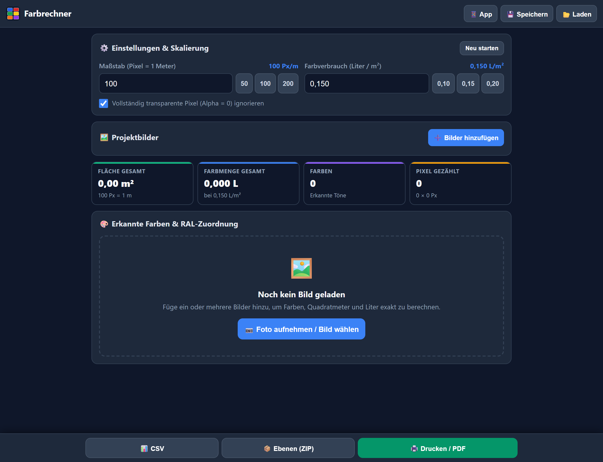
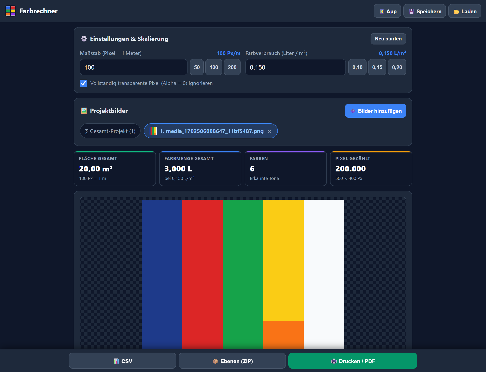
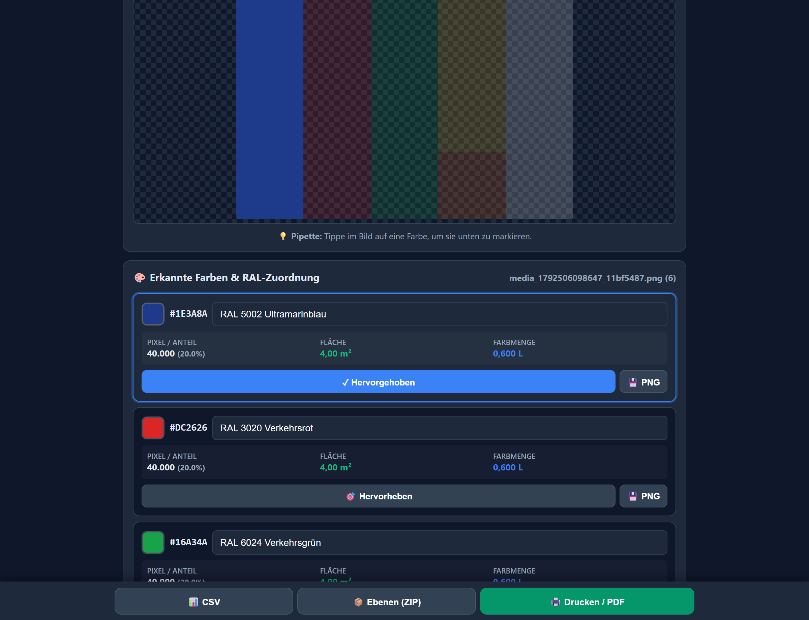
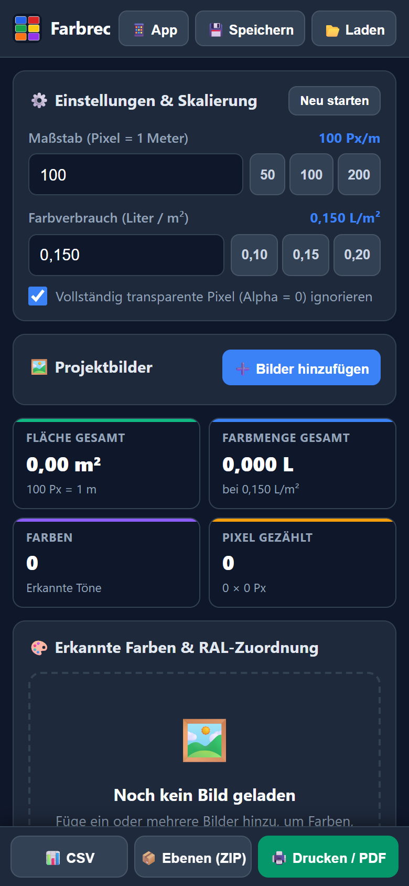
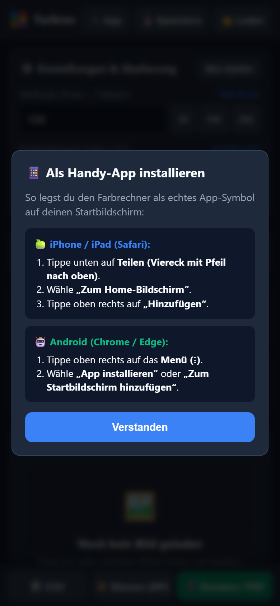
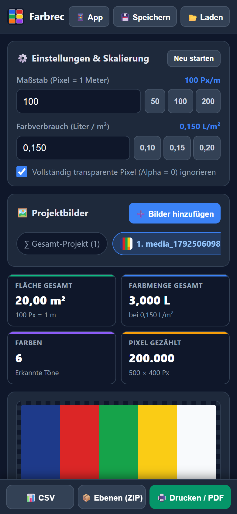
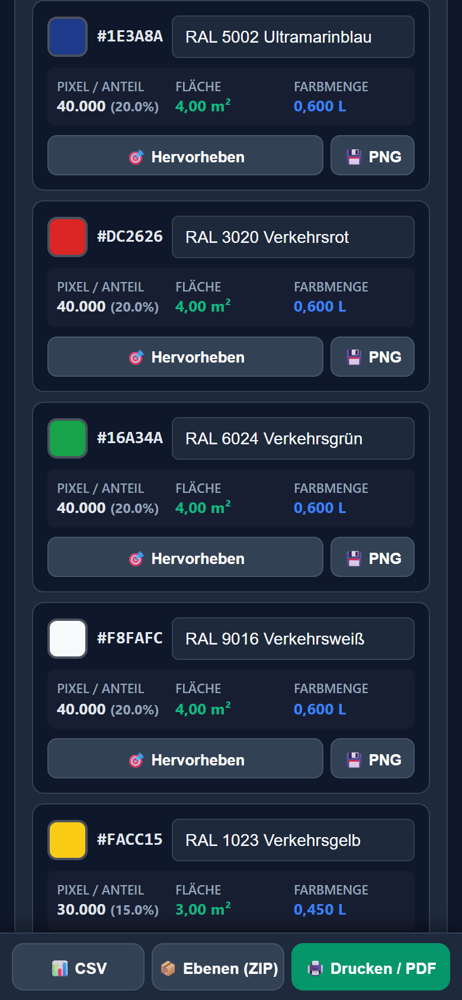

# Bedienungsanleitung: Farb- & Flächenrechner (RAL)

**Offizielle Web-App:** [https://l3nn0.github.io/Farbrechner_RAL/](https://l3nn0.github.io/Farbrechner_RAL/)  
**Technologie:** Progressive Web App (PWA) – funktioniert offline, auf Smartphones, Tablets und PCs.

---

> [!CAUTION]
> ### ⚠️ WICHTIGER HINWEIS: Ausschließlich indizierte PNG-Dateien verwenden!
> 
> Damit der Farbrechner exakte Quadratmeter- und Literangaben ermitteln kann, **müssen indizierte, unkomprimierte PNG-Dateien verwendet werden** (Grafiken mit einer festen Palette aus nur wenigen Echtfarben, z. B. 2 bis 16 Volltonfarben).
>
> #### Warum KEINE herkömmlichen Fotos oder JPEG-Dateien?
> 1. **JPEG-Kompressionsartefakte:** JPEGs komprimieren Pixel in 8×8-Blöcken mit Farbverfälschungen. Selbst ein optisch einheitliches Rot enthält im JPEG hunderte minimal abweichende Farbtöne.
> 2. **Kantenglättung (Anti-Aliasing):** Bei normalen Fotos und unsauberen Grafiken werden Farbränder weichgezeichnet. Der Rechner würde dutzende unerwünschte Mischfarben als separate Farbtöne zählen.
> 3. **Beleuchtungsgradienten:** Reale Fotos von Wänden haben Schatten und Lichteinfall, wodurch kein einheitlicher Farbwert existiert.
>
> #### Was ist ein indiziertes PNG?
> Ein **indiziertes PNG (PNG-8 oder Index-Color PNG)** speichert eine exakte Farbtabelle (Palette). Jedes Pixel des Bildes verweist ohne Kompressionsverlust auf genau einen festen Paletteneintrag.
>
> #### Wie erstellst du die richtige Datei?
> * **Photoshop:** `Bild` → `Modus` → `Indizierte Farbe...` (z. B. 4, 8 oder 16 Farben wählen) und als PNG abspeichern.
> * **GIMP:** `Bild` → `Modus` → `Indiziert...` → Optimale Palette generieren.
> * **Illustrator / Vektorprogramme:** Beim Export als PNG Bildglättung / Anti-Aliasing deaktivieren (`Art Optimized` deaktivieren, keine Transparenzverläufe).
> * **Transparenz:** Freigestellte Flächen (Alpha = 0) werden von der App automatisch erkannt und auf Wunsch nicht mitberechnet.

---

## Teil 1: Anleitung für die PC- / Desktop-Ansicht

Die Desktop-Ansicht bietet maximale Übersicht für Arbeitsvorbereitung, Kalkulation, Bauleitung und Export.

### Schritt 1: Maßstab & Farbverbrauch einstellen
Oben links in der Karte **⚙️ Einstellungen & Skalierung** legst du die Berechnungsgrundlage fest:
1. **Maßstab (Pixel = 1 Meter):**
   * Gib ein, wie viele Pixel im Bild einem realen Meter entsprechen (z. B. `100 Px/m`).
   * Schnellauswahl über die Chips: **50**, **100** oder **200**.
   * *Beispiel:* Bei 100 Px/m entspricht ein Bereich von 100 × 100 Pixeln genau $1{,}00\,\text{m}^2$.
2. **Farbverbrauch (Liter / m²):**
   * Standardmäßig auf `0,150 L/m²` voreingestellt (üblicher Dispersions- bzw. Lackverbrauch pro Anstrich).
   * Schnellauswahl über die Chips: **0,10**, **0,15** oder **0,20**.
3. **Transparenz:** Die Checkbox *„Vollständig transparente Pixel (Alpha = 0) ignorieren“* sorgt dafür, dass freigestellte Bildbereiche nicht als Fläche gezählt werden.

---

### Schritt 2: Projektbilder hochladen & Multi-Image-Verwaltung
1. Klicke auf **➕ Bilder hinzufügen** oder auf den zentralen Bereich **📷 Foto aufnehmen / Bild wählen**.
2. Wähle eine oder mehrere indizierte PNG-Dateien von deiner Festplatte aus.
3. In der Projektleiste erscheinen die hochgeladenen Bilder als Tabs:
   * **∑ Gesamt-Projekt:** Summiert alle hochgeladenen Bilder zu einer Gesamtkalkulation.
   * **Einzeltabs (1, 2, ...):** Klicke auf ein Bild, um nur dieses gezielt zu analysieren.
   * Über das kleine **×** am Chip kann ein Bild wieder entfernt werden.

---

### Schritt 3: Analyse, KPIs & Farbtabelle
Sobald das Bild geladen ist, rechnet die App in Echtzeit:

1. **KPI-Karten (oben):**
   * **Fläche Gesamt:** Summe der bemalten Quadratmeter (z. B. $20{,}00\,\text{m}^2$).
   * **Farbmenge Gesamt:** Benötigte Farbmenge in Litern (z. B. $3{,}000\,\text{L}$).
   * **Farben:** Anzahl der erkannten Reintöne im indizierten Bild.
   * **Pixel gezählt:** Anzahl der belegten Pixel sowie die Bildauflösung.
2. **Farbliste & RAL-Zuordnung:**
   * Jeder Farbton erhält eine eigene Karte mit Farbmuster, HEX-Code, Pixelanzahl, Flächenanteil in Prozent, $\text{m}^2$ und Litern.
   * In das Eingabefeld **RAL-Ton eintragen...** kannst du die gewünschte RAL-Bezeichnung eintragen (z. B. `RAL 5002 Ultramarinblau`). Die Eingabe wird **automatisch im Browser-Speicher (LocalStorage)** gesichert und bleibt für zukünftige Sitzungen erhalten!

---

### Schritt 4: Pipette & Ebenen-Hervorhebung
Möchtest du genau sehen, wo ein Farbton im Bild liegt?

* **Möglichkeit A (Pipette):** Klicke mit dem Mauszeiger direkt im Vorschaubild auf die gewünschte Farbfläche.
* **Möglichkeit B (Button):** Klicke auf der Farbkarte auf **🎯 Hervorheben** oder auf das Farbmuster.
* **Ergebnis:** Alle anderen Farbtöne werden transparent abgeblendet (18% Deckkraft), während die gewählte Farbe voll leuchtet. Oben erscheint ein Banner mit Farbwerten, das du mit **✕ Aufheben** wieder beenden kannst.

---

### Schritt 5: Export & Projektsicherung
Über die Kopfleiste und die feste Fußleiste stehen dir mächtige Werkzeuge zur Verfügung:

| Funktion | Schaltfläche | Beschreibung |
| :--- | :--- | :--- |
| **Drucken / PDF** | 🖨️ Drucken / PDF | Öffnet den sauberen Druckdialog für ein normiertes Baustellen-Datenblatt mit Farbtabelle, Anteilen, $\text{m}^2$ und Liter. |
| **CSV-Export** | 📊 CSV | Exportiert eine formatierte CSV-Datei für Microsoft Excel oder Bau-Abrechnungssoftware. |
| **Ebenen (ZIP)** | 📦 Ebenen (ZIP) | Extrahiert **jede Farbe als eigenes transparentes PNG** in einem ZIP-Archiv – perfekt für Schablonen, Digitaldruck und Plotter! |
| **Einzel-PNG** | 💾 PNG *(auf Karte)* | Lädt gezielt nur diese eine Farbebene als transparentes PNG herunter. |
| **Projekt speichern** | 💾 Speichern *(Header)* | Sichert das gesamte Projekt inklusive Bilder, Skalierung und RAL-Zuweisungen als `.farbprojekt.json`. |
| **Projekt laden** | 📂 Laden *(Header)* | Stellt ein gespeichertes Projekt 1:1 wieder her. |

---

## Teil 2: Anleitung für die Smartphone- / Handy-Ansicht

Die mobile Ansicht ist für die Nutzung auf Baustellen, in Werkstätten und direkt am Objekt optimiert. Alle Bedienelemente sind daumengerecht erreichbar.

  
  &nbsp;&nbsp;&nbsp;&nbsp;
  

### Schritt 1: Als App auf dem Startbildschirm installieren (PWA)
Der Farbrechner kann ohne App Store als vollwertige Offline-App auf dem Homescreen installiert werden:
1. Öffne im mobilen Browser [https://l3nn0.github.io/Farbrechner_RAL/](https://l3nn0.github.io/Farbrechner_RAL/).
2. Tippe oben rechts auf **📱 App** für eine kurze Anleitung:
   * **🍏 Apple iPhone / iPad (Safari):** Unten auf das **Teilen-Symbol** (Viereck mit Pfeil nach oben) tippen ➔ **„Zum Home-Bildschirm“** ➔ **„Hinzufügen“**.
   * **🤖 Android (Chrome / Edge):** Oben rechts auf das **3-Punkte-Menü (⋮)** tippen ➔ **„App installieren“** oder **„Zum Startbildschirm hinzufügen“**.
3. Die App startet fortan im Vollbildmodus ohne störende Browserleisten und funktioniert auch bei schlechtem Netz auf der Baustelle!

---

### Schritt 2: Touch-Bedienung & Vorlagenauswahl
1. Tippe auf **📷 Foto aufnehmen / Bild wählen** oder oben auf **➕ Bilder hinzufügen**.
2. Wähle dein vorbereitetes indiziertes PNG aus deinen Dateien oder aus dem Cloud-Speicher (z. B. Google Drive / iCloud Drive).

---

### Schritt 3: Mobile KPIs & Bildkontrolle

  
  &nbsp;&nbsp;&nbsp;&nbsp;
  

1. **Kompakte KPI-Kacheln:** Sofortiger Überblick über Gesamtkubatur/Fläche ($20{,}00\,\text{m}^2$) und Farbbedarf ($3{,}000\,\text{L}$).
2. **Touch-Pipette:** Tippe mit dem Finger direkt auf ein Farbfeld im Bild. Die App scrollt automatisch zur passenden Farbkarte und markiert den Ton.
3. **Feste Daumenleiste (Bottom Bar):** Am unteren Bildschirmrand hast du jederzeit Schnellzugriff auf:
   * **📊 CSV** (Versand per Mail / Messenger)
   * **📦 Ebenen (ZIP)** (Archiv aller Farbauszüge)
   * **🖨️ Drucken / PDF** (Direkt als PDF auf dem Smartphone sichern oder an einen AirPrint-/WLAN-Drucker senden)

---

## Häufige Fragen & Troubleshooting (FAQ)

### ❓ Der Rechner zeigt hunderte Farben an, obwohl mein Bild nur 4 Farben hat!
* **Ursache:** Das Bild wurde als komprimiertes JPG oder als PNG mit Weichzeichnung (Anti-Aliasing) gespeichert.
* **Lösung:** Bitte das Bild in einem Grafikprogramm öffnen, in den Modus **Indizierte Farben** umwandeln (auf die exakte Anzahl Volltonfarben begrenzen) und neu als PNG speichern.

### ❓ Werden meine RAL-Zuordnungen gelöscht, wenn ich den Browser schließe?
* **Antwort:** Nein. Die RAL-Bezeichnungen werden an den jeweiligen HEX-Code gekoppelt im lokalen Speicher deines Geräts gesichert. Wenn du dasselbe Projekt oder denselben Farbton erneut öffnest, ist der RAL-Name sofort wieder da.

### ❓ Wie sichere ich ein Projekt für Kollegen auf einem anderen Rechner?
* **Antwort:** Klicke oben auf **💾 Speichern**. Du erhältst eine `.farbprojekt.json`-Datei. Dein Kollege kann diese Datei über **📂 Laden** auf seinem PC oder Smartphone öffnen und hat alle Bilder, Einstellungen und RAL-Zuweisungen sofort geladen.
